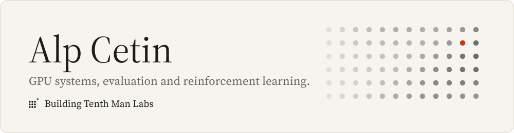
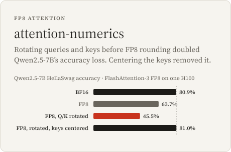
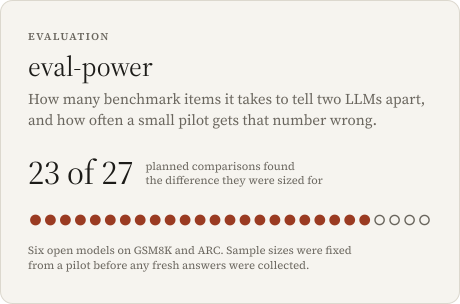
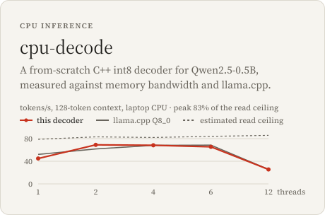
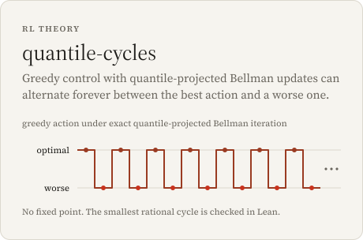
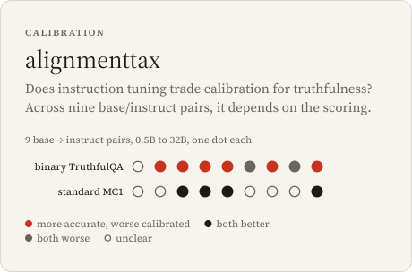
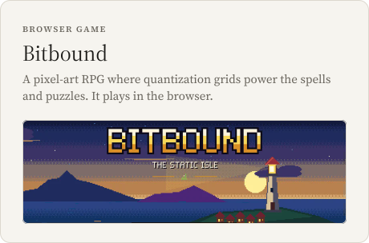

<a href="https://mottopanikeiku.github.io"><picture><source media="(prefers-color-scheme: dark)" srcset="assets/header-dark.svg"></picture></a>

I’m building [Tenth Man Labs](https://tenthmanlabs.com). We put probabilities on geopolitical events, with the sources behind each number and a dated record of how it moved. My background is GPU systems; lately most of my work is evaluation and reinforcement learning.

<a href="https://github.com/mottopanikeiku/attention-numerics"><picture><source media="(prefers-color-scheme: dark)" srcset="assets/attention-numerics-dark.svg"></picture></a>
<a href="https://github.com/mottopanikeiku/eval-power"><picture><source media="(prefers-color-scheme: dark)" srcset="assets/eval-power-dark.svg"></picture></a>
<a href="https://github.com/mottopanikeiku/cpu-decode"><picture><source media="(prefers-color-scheme: dark)" srcset="assets/cpu-decode-dark.svg"></picture></a>
<a href="https://github.com/mottopanikeiku/quantile-cycles"><picture><source media="(prefers-color-scheme: dark)" srcset="assets/quantile-cycles-dark.svg"></picture></a>
<a href="https://github.com/mottopanikeiku/alignmenttax"><picture><source media="(prefers-color-scheme: dark)" srcset="assets/alignmenttax-dark.svg"></picture></a>
<a href="https://mottopanikeiku.github.io/bitbound-quantization-quest/"><picture><source media="(prefers-color-scheme: dark)" srcset="assets/bitbound-dark.svg"></picture></a>

**More:** [seed-power](https://github.com/mottopanikeiku/seed-power) checks pilot-based seed budgets on fresh RL runs. [heliostune](https://github.com/mottopanikeiku/heliostune) autotunes Triton matmuls across four NVIDIA GPUs. [control-clock](https://github.com/mottopanikeiku/control-clock) times a cold Python start to a passing CartPole or Acrobot policy. [verge-lab](https://github.com/mottopanikeiku/verge-lab) picks preference pairs from multi-aspect judge scores.

**In the browser:** [Exit Protocol](https://mottopanikeiku.github.io/exit-protocol/) · [Terrasim](https://mottopanikeiku.github.io/terrasim/) · [PDBView](https://mottopanikeiku.github.io/pdbview/) · [KAN visualizer](https://mottopanikeiku.github.io/kan-visualizer/) · [Durability debt](https://mottopanikeiku.github.io/durability-debt/)

**Contributions:** [PyTorch](https://github.com/pytorch/pytorch/pull/196711) · [Ray](https://github.com/ray-project/ray/pull/66043) · [ONNX](https://github.com/onnx/onnx/pull/8435) · [Sentence Transformers](https://github.com/huggingface/sentence-transformers/pulls?q=is%3Apr+author%3Amottopanikeiku+is%3Amerged) · [SGLang](https://github.com/sgl-project/sglang/pull/32172) · [Celery](https://github.com/celery/celery/pull/10811) · [Arcade Learning Environment](https://github.com/Farama-Foundation/Arcade-Learning-Environment/pull/743) · [Gymnasium-Robotics](https://github.com/Farama-Foundation/Gymnasium-Robotics/pull/344)

[mottopanikeiku.github.io](https://mottopanikeiku.github.io) · [LinkedIn](https://www.linkedin.com/in/fatihctn)
